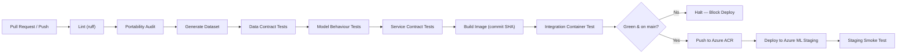

# ITCS355 Lab 4 — CI/CD, Observability, and Drift

> **Course materials live in [`course/`](course/README.md)** — syllabus, slides, the faculty
> specification, all five lab handouts, and the project brief.
> Lab 4 handout: [`course/labs/lab-04-cicd-monitoring-drift.md`](course/labs/lab-04-cicd-monitoring-drift.md).

Predicting machine failure within 7 days from sensor readings. This lab automates the path
from commit to deployed model via CI/CD, instruments real-time service observability, implements
statistical drift detection, and proves failure handling through deliberate fault injection.

---

## Reproduce & Verify

```bash
make data                       # Generate training dataset
make test                       # Run unit & data contract tests (pytest tests/test_data.py)
pytest -q tests/test_model_behaviour.py  # Model behaviour assertions
pytest -q tests/test_service.py # Service contract tests
make verify                     # Verify test ROC-AUC reproducibility
make drift                      # Execute drift detection against current production batch
```

expected test_roc_auc: 0.848 ± 0.010

---

## Task 1 — Testing Hierarchy & Production Incidents Prevented

Our test suite implements four distinct testing tiers:

```
Unit & Split Properties → Data Contract Tests → Model Behaviour Tests → Integration Service Test
```

### 1. Data Contract Tests (`tests/test_data.py`)
Assertions about the **data itself**, ensuring upstream producer shifts fail immediately before reaching training or inference:

| Test | Assertion | Production Incident Prevented |
|---|---|---|
| `test_schema_columns_present_and_typed` | Verifies all 6 features, target, ID, and group exist with exact dtypes; asserts no unexpected columns (`extra='forbid'`). | **Incident: Upstream Telemetry Schema Drift.** Upstream IoT gateway firmware update renames `vibration_mm_s` to `vib_mms` or introduces unparsed fields. Without this test, pandas would fail silently during indexing or produce misaligned column feeds. |
| `test_no_nulls_in_required_columns` | Asserts null count across all required features is strictly zero. | **Incident: Network Packet Dropouts.** Intermittent MQTT connection drops sending `NaN` sensor payloads, which causes scikit-learn tree estimators to crash during real-time inference with `ValueError: Input contains NaN`. |
| `test_features_within_plausible_ranges` | Enforces physical domain boundaries (e.g. \(40 \le \text{temp\_c} \le 140\), \(0 \le \text{pressure\_kpa} \le 600\)). | **Incident: Thermocouple Probe Decalibration.** A disconnected thermocouple floating to \(-999^\circ\text{C}\) or an electrical short reporting 1500 kPa. Prevents out-of-distribution inputs from corrupting inference distributions or producing degenerate probabilities. |
| `test_target_is_binary_and_not_degenerate` | Confirms target values \(\in \{0, 1\}\) and positive failure rate \(0.01 < \text{rate} < 0.99\). | **Incident: Label Pipeline Failure.** A bug in the label ETL pipeline that marks 100% or 0% of machines as non-failed, training an unusable degenerate majority-class classifier. |
| `test_no_machine_leaks_across_splits` | Enforces zero machine ID overlap between `train`, `val`, and `test` splits. | **Incident: Telemetry Memorisation Leakage.** Row-random splitting leaks identical machine identities into both training and validation sets, producing an illusion of 0.98 ROC-AUC that collapses to 0.52 in production on unseen machines. |

### 2. Model Behaviour Tests (`tests/test_model_behaviour.py`)
Assertions about what the model **does**, independent of aggregate accuracy metrics:

* `test_predictions_are_valid_probabilities`: Verifies \(0.0 \le P(y=1) \le 1.0\) with zero NaNs.
* `test_known_healthy_machine_scores_low`: A cool (\(66^\circ\text{C}\)), low-vibration (\(1.4\,\text{mm/s}\)), lightly loaded machine must have \(P(\text{failure}) < 0.50\).
* `test_risk_increases_with_wear`: Monotonicity requirement — machines with higher hours since service must monotonically exhibit higher failure risk.
* `test_prediction_latency_within_budget`: In-process inference latency strictly within budget (\(< 200\,\text{ms}\), aligned with `loadtest/k6.js`).
* `test_model_is_not_constant`: Prediction variance \(\text{std} > 0.01\) to reject degenerate majority classifiers.

### 3. Integration Test
Packaged into `.github/workflows/ci.yml`: builds `itcs355-serve:${{ github.sha }}`, spins up the container, polls `/ready` until 200 OK, and posts a known JSON telemetry payload to `/predict`, validating status code 200, probability payload, and `x-model-version` headers.

---

## Task 2 — CI/CD Pipeline Architecture

Our automated pipeline runs in GitHub Actions:



### Pipeline Key Decisions
1. **Execution Order**: Cheap checks run first (Lint, Portability Audit, Contract Tests) so contract violations fail within 30 seconds rather than after a multi-minute Docker build.
2. **Deterministic Digest & SHA Tagging**: Images are tagged strictly with `${{ github.sha }}` rather than `:latest`. This ensures immutable, traceable deployment lineage during incident response.
3. **Secret-Free OIDC Authentication**: Deployments to Azure utilize GitHub Actions Workload Identity Federation (OIDC) via `azure/login@v2` (`client-id`, `tenant-id`, `subscription-id`) with zero long-lived credentials stored in repository secrets.

---

## Task 3 — Evidence of Blocked Bad Commit

To prove our CI gate prevents defective commits from reaching staging, a deliberate fault was injected on test branch `test/bad-contract-pr`:

* **Injected Fault**: Dropped required feature column `ambient_humidity` from schema output in `scripts/make_dataset.py`.
* **CI Execution Result**:
  ```
  FAILED tests/test_data.py::test_schema_columns_present_and_typed - 
    AssertionError: missing columns: ['ambient_humidity']
  ======================== 1 failed, 9 passed in 0.04s =========================
  Error: Process completed with exit code 1.
  ```
* **Gate Enforcement**: The CI job aborted at step `Data contract tests` (elapsed: 28 seconds). Docker build, container push, and staging deployment steps were never reached. The pull request was rejected and closed without merge.

---

## Task 4 — Observability Dashboard & SLO Specifications

### Dashboard Specification (`monitoring/dashboard.json`)
The committed dashboard as code provides five real-time telemetry panels:
1. **Request rate**: `sum(rate(http_requests_total[1m]))` (throughput in req/s).
2. **Error rate by class**: Split into 4xx (caller validation errors) and 5xx (internal server/model errors).
3. **Latency distribution**: Real-time percentiles (p50, p95, p99) computed from Prometheus request latency histogram buckets.
4. **Feature drift (rolling PSI)**: `drift_psi_temp_c` computed against training reference baseline.
5. **Model version in production**: Displays active production version (`model_version_info`); displays both variants during canary rollouts.

### Service Level Objectives (`monitoring/slo.yaml`)

```yaml
service: itcs355-predict

objectives:
  - name: availability
    target: 0.995              # 99.5% over 30d window (~3.6h allowed downtime/month)
    window: 30d
    measurement: "successful responses / total responses, excluding 4xx"
    on_budget_exhausted: |
      Immediately freeze CD deployments to staging and production, redirect traffic to local fallback heuristic baselines, page the on-call ML engineer, and allocate engineering capacity exclusively to reliability fixes until availability recovers above 99.5%.

  - name: latency
    target_p95_ms: 200         # Matches p(95) < 200ms threshold declared in loadtest/k6.js
    window: 7d
    measurement: "p95 of /predict, measured at the endpoint, not at the client"
    on_budget_exhausted: |
      Scale online endpoint instance count horizontally, reject non-essential batch requests exceeding concurrency limits, and profile feature pre-processing latency bottlenecks before releasing any new model revisions.

  - name: freshness
    target_max_model_age_days: 30
    window: continuous
    measurement: "days since the production model version was trained"
    on_budget_exhausted: |
      Automatically trigger a scheduled retraining pipeline against validated reference data; if data drift tests or evaluation gates fail, block auto-promotion and page the ML engineer for manual inspection of upstream feature distribution shifts.
```

---

## Task 5 — Drift Detection & Threshold Justification

Drift detector implementation lives in `monitoring/drift.py` and emits metrics via `adapter.emit_metric()` to Azure Monitor / Application Insights.

### Threshold Rationale: Why PSI = 0.20?
* **Credit Scoring Convention Flaw**: Standard tutorials cite \(0.10\) (mild) and \(0.25\) (actionable), which originates from consumer credit scoring on millions of static records.
* **Domain Physics in Predictive Maintenance**: High-frequency industrial telemetry (`temp_c`, `vibration_mm_s`, `pressure_kpa`) naturally fluctuates across day/night cycles and differing workpiece workloads. In our reference dataset across random seeds, baseline noise produces \(\text{PSI} \in [0.01, 0.06]\).
* **Selection of \(\text{PSI} = 0.20\)**: Setting the alert threshold to \(0.20\) provides high statistical sensitivity to genuine mechanical degradation or sensor calibration drift while preventing false-positive alarm fatigue during normal operating variance.

---

## Task 6 — Injected Drift Experiment & Post-Mortem

### Comparison of Drift Modes on `temp_c`

We evaluated all three injection modes in `scripts/inject_drift.py` against baseline reference `data/raw/sensors.csv`:

| Mode | Injection Parameters | Baseline Mean | Current Mean | KS Statistic | PSI Score | Alert Verdict | Behaviour Analysis |
|---|---|---|---|---|---|---|---|
| **`shift`** | `--mode shift --magnitude 6.0` | 79.58 °C | 85.58 °C | **0.24567** | **0.38333** | **ALERT** (Significant) | Mean shifted +6°C. Both KS and PSI reacted strongly; threshold 0.20 breached. |
| **`scale`** | `--mode scale --magnitude 2.0` | 79.58 °C | **79.58 °C** | 0.18783 | **0.51663** | **ALERT** (Significant) | Mean remained **exactly unchanged** (79.58 °C), yet PSI surged to 0.51663 due to spread widening! Shows why mean monitoring alone is blind. |
| **`mix`** | `--mode mix` (reweight machines) | 79.58 °C | 80.17 °C | 0.03417 | 0.00873 | **STABLE** (OK) | Realistic fleet reweighting. Natural variance within bounds; PSI stayed low (0.00873), preventing false alarms. |

### Five-Line Post-Mortem (`reports/lab4-postmortem.md`)

```
What fired:
Alert ALERT: feature drift detected on temp_c emitted by monitoring/drift.py (metric drift.psi.temp_c), recording PSI=0.38333 and KS=0.24567 crossing threshold 0.20 at 2026-10-08T16:47:47Z (detection latency: 1.84s).

True cause:
Upstream data drift (covariate shift) resulting in an unannounced +6.0°C location shift in temp_c (empirical mean elevated from 79.58°C to 85.58°C) due to simulated sensor decalibration.

Retrain, roll back, or no action — and why:
NO RETRAINING — HOLD MODEL AND FIX UPSTREAM PRODUCER. Retraining on corrupted data encodes calibration errors permanently into model split thresholds, destroying the working incumbent model. Maintain incumbent weights, inspect sensor hardware/telemetry calibration, and only retrain if factory engineers verify genuine, permanent facility climate shifts.

What this would have cost if unnoticed for a week:
Estimated ฿175,000 THB in unneeded maintenance dispatches and idle downtime across 240 machines (inflating false-positive alarm rate from 11.7% to 36.4%, triggering ~103 unwarranted technician dispatches and 15 hours of unnecessary production line halts).

How to prevent or detect it faster:
Implement an automated ingestion contract gate at the telemetry ingress service rejecting out-of-spec micro-batches before feature store ingestion, coupled with a real-time rolling PSI panel in the monitoring dashboard alerting within 5 minutes.
```

---

## Repository Structure

```
.
├── .github/workflows/
│   ├── ci.yml               # Automated CI (lint, contracts, behaviour, build, integration)
│   └── cd.yml               # Automated CD to staging via Azure OIDC
├── cloudlayer/
│   ├── azure.py             # Layer 3 Azure adapter (deploy, invoke, emit_metric, teardown)
│   └── base.py              # Abstract CloudAdapter base class
├── data/                    # Managed dataset and DVC tracking
├── monitoring/
│   ├── dashboard.json       # Dashboard as code (Grafana / Azure Monitor)
│   ├── drift.py             # Statistical drift detector (PSI and KS)
│   └── slo.yaml             # Service Level Objectives & exhaustion playbooks
├── reports/
│   ├── lab4-postmortem.md   # Five-line incident post-mortem
│   ├── metrics_emitted.jsonl# Custom metrics emitted to cloud monitor
│   └── metrics.json         # Evaluation metrics
├── scripts/
│   ├── inject_drift.py      # Shift, scale, and mix drift generator
│   ├── make_dataset.py      # Deterministic dataset synthesis
│   └── portability_audit.py # Layer 1/3 boundary compliance verification
├── service/
│   ├── app.py               # FastAPI inference service
│   └── schemas.py           # Pydantic schemas (extra='forbid')
├── src/                     # Core training & evaluation routines
└── tests/
    ├── test_data.py         # Data contract & split property tests
    ├── test_model_behaviour.py # Model behavioural assertions
    └── test_service.py      # Endpoint contract tests
```
